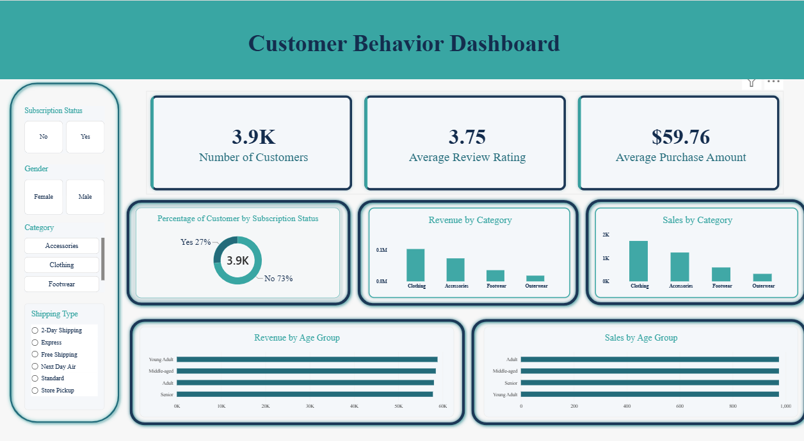

## Customer Behavior Data Analyst Project👨🏻‍💻

An end-to-end **Customer Behavior Analysis** project using Python, SQL (PostgreSQL), and Power BI to transform raw retail customer data into meaningful business insights and data-driven recommendations.
This project demonstrates a complete data analytics workflow, covering data cleaning, exploratory data analysis (EDA), database integration, SQL analysis, and interactive dashboard development.

## 🎯 Project Overview
The primary objective of this project is to analyze customer shopping behavior, identify purchasing patterns, understand customer segments, and generate actionable business insights.
The project follows a real-world data analytics workflow, similar to the responsibilities of a professional Data Analyst.

## Key Objectives
- Clean and prepare raw customer shopping data.
- Perform Exploratory Data Analysis (EDA) using Python.
- Store and manage structured data using PostgreSQL.
- Analyze customer behavior using SQL queries.
- Build an interactive Power BI dashboard.
- Generate business insights and recommendations.

## 🛠️ Tech Stack

**🐍 Programming & Data Analysis**
- Python
- Pandas
- NumPy

**📊 Data Visualization**
- Power BI
- Matplotlib
- Seaborn

**🗄️ Database & Querying**
- PostgreSQL
- SQL

**💻 Development & Version Control**
- VS Code
- pgAdmin 4
- Git & GitHub
  
## 🔄 Project Workflow

The project is divided into four major phases:

### 1. Data Preparation & EDA (Python)

- Imported the raw customer shopping dataset.
- Explored the dataset using Pandas.
- Checked for missing values and duplicate records.
- Handled missing values using appropriate techniques.
- Performed data cleaning and preprocessing.
- Created new analytical columns, including customer age groups.
- Explored customer demographics and purchasing patterns.

### 2. Database Integration & SQL Analysis (PostgreSQL)

- Created a PostgreSQL database.
- Connected Python with PostgreSQL.
- Loaded the cleaned dataset into the database.
- Executed SQL queries to answer business questions.
- Analyzed customer segments, product categories, purchase amounts, and shopping preferences.

### 3. Data Visualization (Power BI)

- Connected PostgreSQL with Power BI.
- Imported the cleaned customer data.
- Created interactive charts, graphs, and KPIs.
- Designed a dashboard to highlight important customer behavior patterns.
- Presented key business insights through visualizations.

### 4. Insights & Business Recommendations

- Identified important customer purchasing trends.
- Analyzed spending behavior across different age groups.
- Explored customer preferences and product performance.
- Developed recommendations to improve customer engagement and business performance.

## 📊 Dashboard Preview

* Developed recommendations to improve customer engagement and business performance.



## 📁 Project Structure

The Power BI dashboard focuses on visualizing important customer shopping metrics and patterns.

```text
Customer-Behaviour-Analysis/
│
├── README.md
├── requirements.txt
├── .gitignore
├── customer_shopping_behavior.csv
├── customer_behaviour.py
├── customer_analysis.sql
├── Customer-behaviour.pbix
└── dashboard.png
```

**🚀 Getting Started**
Follow these steps to run the project locally.

### 1. Clone the Repository
git clone https://github.com/matrika30/Customer-Behaviour-Analysis
Navigate to the project directory:
```bash
cd Customer-Behavior-Analysis
```
### 2. Install Required Libraries
```bash
pip install pandas numpy matplotlib seaborn sqlalchemy psycopg2-binary
```
### 3. Run Python Analysis
Open the Python file in VS Code or Jupyter Notebook and execute the data cleaning and preprocessing steps.
### 4. Connect to PostgreSQL
- Create a PostgreSQL database.
- Configure your database connection in the Python script.
- Load the cleaned dataset into PostgreSQL.
- Execute the SQL queries from the SQL folder using pgAdmin or another SQL client.
### 5. Open Power BI Dashboard
- Open Power BI Desktop.
- Connect to your PostgreSQL database.
- Load the required customer behavior table.
- Open or recreate the dashboard using the provided `.pbix` file.
## 💡 Business Questions
The analysis aims to answer questions such as:
1. Which customer age groups contribute the most to purchases?
2. What is the average purchase amount?
3. Which product categories are most popular?
4. How do customer demographics influence shopping behavior?
5. Which customers demonstrate greater purchasing activity?
6. What patterns can be identified in customer shopping preferences?
7. How can businesses improve customer retention and engagement?

## 📈 Key Learnings
Through this project, I gained practical experience in:
- Data cleaning and preprocessing using Python.
- Exploratory Data Analysis (EDA).
- Working with Pandas and NumPy.
- Connecting Python with PostgreSQL.
- Writing SQL queries for business analysis.
- Integrating PostgreSQL with Power BI.
- Creating interactive dashboards.
- Translating analytical findings into business insights.
## 🔮 Future Improvements
- Perform advanced customer segmentation using RFM analysis.
- Apply machine learning techniques for customer purchase prediction.
- Develop customer churn prediction models.
- Add more interactive Power BI visualizations.
- Automate data updates and reporting.

## 🎥 Learning Resources

This project was inspired by the following tutorial:

**YouTube:** [Customer Behavior Data Analysis Project](https://www.youtube.com/watch?v=5PrZvPeUw60&list=PLAx-M6Di0SisFJ1rv5M_FRHUlGA5rtUf_&index=3)

**Reference Repository:** [Customer Trends Data Analysis](https://github.com/amlanmohanty1/customer-trends-data-analysis-SQL-Python-PowerBI)

## 👩🏻‍💻 Author

**Matrika Badjatya**

B.Tech Computer Science Engineering Student | Aspiring Data Analyst

Interested in Data Analytics, Python, SQL, Power BI, and Artificial Intelligence.

- GitHub: https://github.com/matrika30
- LinkedIn: https://www.linkedin.com/in/matrika-badjatya/


⭐ If you find this project useful, consider giving this repository a star!

**Turning Data into Insights, and Insights into Decisions.** 🚀
